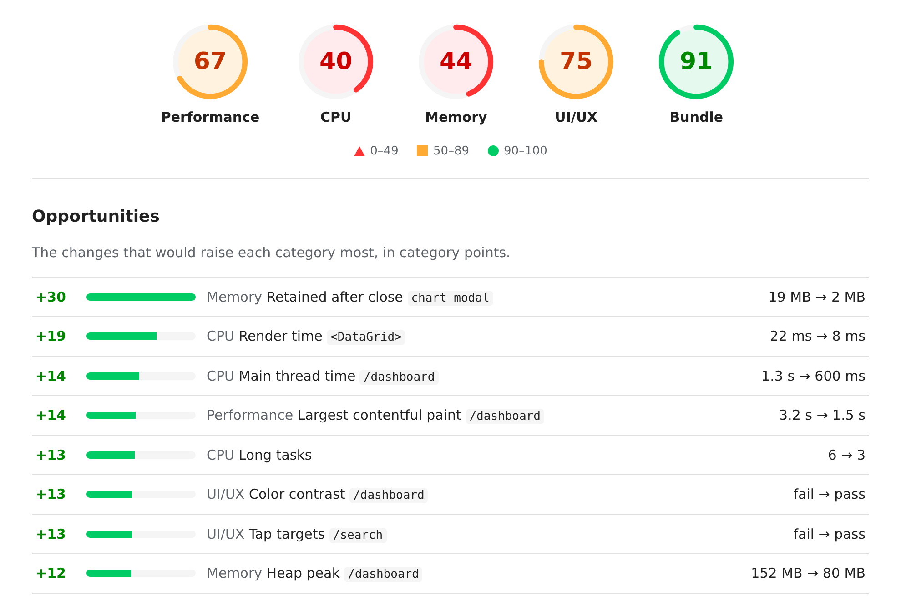

<h1 align="center">Uphill</h1>

<p align="center">
  Continuous metrics and hill climbing
</p>

<p align="center">
  <a href="#overview">Overview</a> · <a href="#problem">Problem</a> · <a href="#solution">Solution</a> · <a href="#install">Install</a> · <a href="#agents">Agents</a> · <a href="#usage">Usage</a> · <a href="#github-action">GitHub Action</a> · <a href="docs/README.md">Documentation</a>
</p>

<picture>
  <source media="(prefers-color-scheme: dark)" srcset=".github/report-dark.png">
  
</picture>

## Overview

Uphill scores a project against its own targets. A metric is anything a script can measure: bundle size, page load time, request latency, memory, test coverage, lint warnings, or an eval score. Uphill runs the scripts, scores each metric from 0 to 100, and names the fixes worth the most points.

## Problem

Most projects track their numbers in one-off scripts and CI checks that pass or fail. A check says whether a limit broke, not how far the project is from its target or which fix would help most. Regressions slip under loose limits, and improvements fade because nothing records them.

## Solution

Uphill turns every metric into a score and every gap into a next step. Scripts measure with the tools the project already uses. Each run shows where the project stands, so a person or an agent can climb toward the targets one fix at a time.

```yaml
# 1. .agents/uphill.yaml: the footprint category, its script, and its metric.
footprint:
  run: sh .agents/metrics/footprint.sh
  bundle-size: {}
```

```yaml
# 2. .agents/uphill.baseline.yaml: the metric's target, and later its accepted value.
footprint:
  bundle-size: { target: 5kB }
```

```sh
# 3. .agents/metrics/footprint.sh: measure the gzipped bundle and write one metric line.
echo "bundle-size $(gzip -c dist/index.js | wc -c)B" >> "$UPHILL_METRICS"
```

```text
$ uphill
■  75  footprint
  ■  75  bundle-size  6.9 kB  target 5 kB

Opportunities
  +15  footprint  bundle-size  6.9 kB → 5 kB
```

Each run also writes `.uphill/report.html`, with a gauge per category and the opportunities worth the most points, like the report at the top of this page.

## Install

```sh
# Install the latest release to ~/.uphill/bin on macOS or Linux.
curl -fsSL https://raw.githubusercontent.com/wevm/uphill/main/install.sh | sh

# Or run the latest release with npx.
npx uphill

# Or build it from source with Cargo.
cargo install --locked --git https://github.com/wevm/uphill uphill
```

## Agents

[`SKILL.md`](SKILL.md) is the `devising-metrics` skill. It guides an agent to choose metrics: deep metrics for each surface, existing tools before custom measurements, the [packs](packs) that fit, and targets about 10 times better than the project is now. `uphill init` ends its brief with the skill.

```text
Run `npx uphill init` and set up Uphill as its brief describes. Use its devising-metrics skill to devise deep metrics with ambitious targets.
```

## Usage

Uphill reads `uphill.yaml` or `uphill.toml`, at the project root or in `.agents/`, from the current directory or the nearest parent. Scripts run from the project root. Add `.uphill/` to `.gitignore`.

```sh
# Score every category, list opportunities, and compare with each metric's baseline.
uphill

# Score one category.
uphill speed

# Accept this run: write its values beside their targets in uphill.baseline.yaml.
uphill --update

# Fail when anything differs from the baselines.
uphill --require-baseline

# Fail when a metric misses its target or a script fails.
uphill --require-targets

# Compare with another revision: timings in interleaved pairs, and exact values with its baselines.
uphill --compare main

# Run each script once and check its lines, without scoring.
uphill check

# Print a brief for an agent to set up Uphill in this project, with the devising-metrics skill.
uphill init

# Pin a pack to a commit and vendor it into .agents/packs, after a review of its code.
uphill add wevm/uphill/packs/typescript@main

# Review and take the newest commit of each pack.
uphill update

# Check that each vendored pack matches its pinned commit.
uphill audit

# Print the scores, missed targets, and opportunities in a few lines, for agent loops.
uphill --compact

# Keep this run as a Git note on HEAD, for trends in report.html and `uphill log`.
uphill --note

# Write .uphill/dashboard.html from the newest noted runs of several repositories.
uphill dashboard wevm/uphill ../app

# List the commits that changed a metric's baseline, or the runs noted for it.
uphill log footprint bundle

# Name the commit that last moved a metric, bisecting commits when no baseline records it.
uphill blame speed startup
```

## GitHub Action

The action runs `uphill --compare` against the base branch of each pull request, and keeps one comment on the pull request with `report.md`. The job summary also has the report, and the job fails when `uphill` fails.

```yaml
# .github/workflows/uphill.yml: score each pull request and compare it with its base branch.
name: Uphill
on: pull_request

jobs:
  uphill:
    permissions:
      contents: read
      pull-requests: write
    runs-on: ubuntu-latest
    steps:
      - uses: actions/checkout@v7
      # Install the tools the scripts run here, such as Bun.
      - uses: wevm/uphill@main
        with:
          args: --require-targets
```

## Documentation

[`docs/`](docs/README.md) has a guide for each task, from writing scripts to comparing revisions, and a reference page for every key, flag, and report field.

## License

[MIT](LICENSE)
